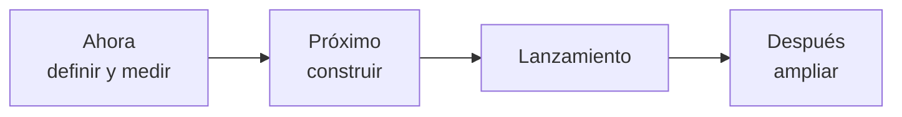
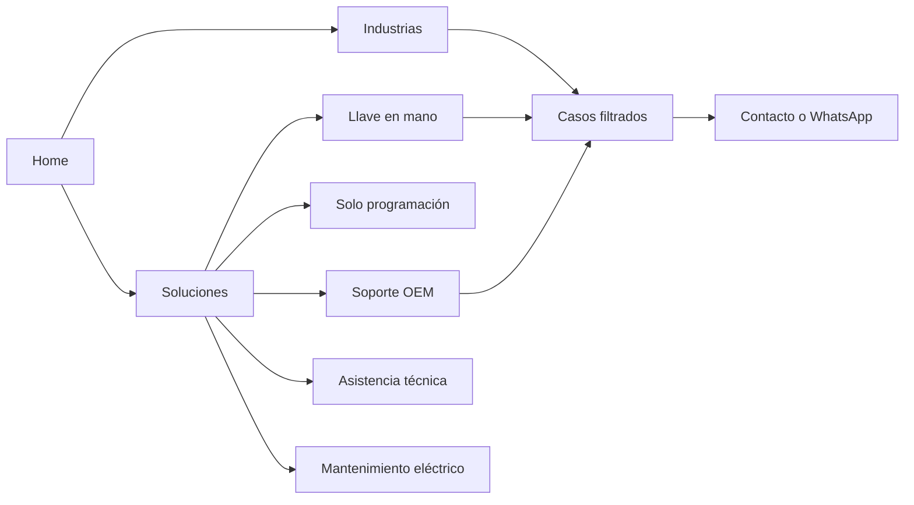

# Propuestas para el sitio nuevo — Qubit (qubit.la)

25 de septiembre de 2026 · actualizada el 29 de septiembre de 2026 · @Lourdes

## Resumen ejecutivo

14 mejoras cubren los 26 hallazgos de la auditoría y las oportunidades del rediseño. Son requisitos para el sitio nuevo, no arreglos al WordPress actual (salvo la medición en GTM de MEJ-01, que no toca el WordPress).

El objetivo es que un comprador industrial o un fabricante de máquinas:

- entienda en segundos qué hace Qubit
- encuentre la solución y los casos de su industria
- deje su consulta por WhatsApp o por formulario, con confianza

Y que Qubit pueda medir cuánto convierte la web y mantenerla viva con contenido nuevo.

**Las 3 de mayor valor** (las de mayor impacto en conversión):

- **MEJ-02:** hero con propuesta de valor, una imagen que luzca y un CTA con beneficio.
- **MEJ-04:** tarjeta de caso reconocible y listado de proyectos con encabezado y filtros.
- **MEJ-13:** landings por industria con brochure descargable. Ninguno de los cuatro competidores las tiene, y sirven como destino de las campañas de Google Ads.

| Cuadrante | Mejoras | Cuándo |
| --- | --- | --- |
| Quick win | 7 | Ahora: decisiones de diseño, contenido y medición de poco esfuerzo |
| Proyecto estratégico | 7 | Próximo: piezas de más trabajo del lanzamiento |

Las dos fases entran en la primera versión del sitio. No hay fecha definida.

**Cambios respecto de la versión del 25/09:**

- Suma el contexto del proyecto de rediseño.
- Usa los cuatro competidores actuales y las mediciones de Lighthouse.
- MEJ-13 (landings por industria) pasa de «Después» a «Próximo».
- Nueva MEJ-14: reactivar Noticias con carga asistida.
- MEJ-05 (inglés) se acota a las páginas clave.
- MEJ-01 (medición) sube a impacto alto por Google Ads.

## Oportunidades que cubre

| Oportunidad | Mejora(s) |
| --- | --- |
| Rehacer el sitio desde cero | Todo el documento; migración sin perder posicionamiento en MEJ-11 |
| Hero con una imagen que luzca | MEJ-02 (foto horizontal con recorte por breakpoint), MEJ-10 (peso) |
| WhatsApp más visible | MEJ-03 (botón con etiqueta y contraste alto), MEJ-09 (nombre accesible) |
| Jerarquía en el botón de contacto | MEJ-02 (un CTA primario con beneficio y uno secundario) |
| Sección de proyectos con encabezado claro | MEJ-04 (encabezado, todos los casos, tarjeta propia y filtros) |
| Noticias activa | MEJ-14 (Noticias con ritmo y carga asistida) |
| Landings por industria o caso de uso | MEJ-13 (landings con brochure), MEJ-06 (arquitectura) |
| Versión en inglés | MEJ-05 (inglés en páginas clave) |
| Medir cuánto convierte la web | MEJ-01 (medición y conversiones por evento) |
| Carga de contenido asistida con Claude | MEJ-14 (modelo de contenido y flujo de carga), MEJ-06 |

## Quick wins

Son decisiones de poco esfuerzo que conviene fijar al empezar el diseño. MEJ-01 va primero porque la línea base se junta en el sitio actual.

| ID | Qué hacer | Resuelve |
| --- | --- | --- |
| MEJ-01 | Medir leads, conversiones y comportamiento desde antes del lanzamiento | Habilitante · SEO-01 (conversiones) |
| MEJ-02 | Diseñar un hero con propuesta de valor, imagen que luzca y CTA con beneficio | CONT-01, UX-02, UI-04, A11Y-05 |
| MEJ-03 | Hacer visible el botón de WhatsApp y acortar el formulario | UI-05, UX-07, A11Y-06 |
| MEJ-07 | Preparar el contenido: testimonios validados, guía de tono, beneficios con datos y credenciales | CONT-02, CONT-04, CONT-05, CONT-06 |
| MEJ-08 | Definir un sistema visual accesible | A11Y-03, A11Y-05 |
| MEJ-09 | Construir las plantillas con accesibilidad WCAG 2.2 AA de base | A11Y-01, A11Y-02, SEO-02 |
| MEJ-10 | Fijar un presupuesto de performance | PERF-01 |

## Matriz impacto × esfuerzo

|  | Esfuerzo bajo | Esfuerzo medio | Esfuerzo alto |
| --- | --- | --- | --- |
| **Impacto alto** | MEJ-01, MEJ-02, MEJ-03, MEJ-07, MEJ-09, MEJ-10 | MEJ-04, MEJ-06, MEJ-11, MEJ-12, MEJ-13 | — |
| **Impacto medio** | MEJ-08 | MEJ-05, MEJ-14 | — |
| **Impacto bajo** | — | — | — |

## Roadmap del rediseño



Las dos primeras fases forman la primera versión del sitio.

| Fase | Mejoras | Prioridad Jira |
| --- | --- | --- |
| Ahora | MEJ-01, MEJ-02, MEJ-03, MEJ-07, MEJ-08, MEJ-09, MEJ-10 | High |
| Próximo | MEJ-04 Casos · MEJ-13 Landings por industria · MEJ-06 Arquitectura · MEJ-11 Migración SEO · MEJ-12 Privacidad · MEJ-14 Noticias · MEJ-05 Inglés | High (MEJ-05 y MEJ-14: Medium) |
| Después | Más landings por industria, inglés en el resto del sitio y ajustes según las métricas de MEJ-01 | Medium |

Conviene arrancar ya con cinco cosas, porque condicionan el diseño:

- la elección de la plataforma: tiene que permitir cargar contenido por API (MEJ-14)
- la redacción legal (MEJ-12)
- el mapa de URLs (MEJ-11)
- los brochures e industrias prioritarias (MEJ-13)
- las páginas que van en inglés (MEJ-05)

## Propuestas — fase Ahora

### MEJ-01 · Medir leads, conversiones y comportamiento desde antes del lanzamiento

Resuelve SEO-01 (en su parte de conversiones) · Impacto alto · Esfuerzo bajo · Quick win · Habilitante

**Qué cambiar.**

- **En el sitio actual:** configurar en Google Tag Manager, que ya está instalado, los eventos de envío de formulario, clic en WhatsApp, clic en teléfono y clic en email. No hace falta tocar el WordPress. Importarlos como conversiones en Google Ads y juntar una línea base hasta el lanzamiento.
- **Segmentación:** separar por dispositivo (desktop y mobile) y por origen (Ads, orgánico, directo).
- **Comportamiento:** instalar Microsoft Clarity desde GTM (ver el detalle más abajo) y quitar Zoho PageSense, para no cargar dos herramientas que hacen lo mismo.
- **En el sitio nuevo:** los mismos eventos con los mismos nombres, más el idioma, la landing de origen y las descargas de brochure (MEJ-13).
- **Limpieza:** quitar el píxel de Meta duplicado.

**Por qué.**

- Qubit invierte en Google Ads y hoy no sabe cuánto convierte la web.
- Sin línea base no se puede demostrar que el sitio nuevo capta más leads.
- Hoy, las páginas de gracias indexables pueden contar como conversiones visitas que no vienen del formulario.
- Los eventos dicen **cuántos** convierten; Clarity muestra **por qué** no lo hacen los demás.

**Microsoft Clarity: qué es y para qué nos sirve.** Es una herramienta gratuita de Microsoft, sin límite de tráfico, que registra cómo los usuarios usan el sitio [22]. Incluye:

- mapas de calor de clics, scroll y atención
- grabaciones de sesiones
- detección automática de clics de frustración (rage clicks) y clics sin respuesta (dead clicks)
- embudos
- resúmenes con IA

Se integra con GA4 y con Google Ads [22].

Para Qubit, sirve para:

- **Ver qué hace quien llega desde un anuncio:** filtrar las sesiones por campaña y ver si lee el hero, si llega a los casos o si se va enseguida. Así se detectan anuncios que traen tráfico que no convierte.
- **Validar con datos reales lo que encontró la auditoría:** por ejemplo, si la gente hace clic en las tarjetas de industria que no llevan a ningún lado (UX-04), si ignora las tarjetas de caso (UX-09) o si no encuentra el botón de WhatsApp (UI-05). Los clics sin respuesta lo muestran directamente.
- **Ver hasta dónde scrollean:** si llegan a los casos, los testimonios y el formulario, en desktop y en mobile por separado.
- **Entender los abandonos del formulario:** en qué campo dejan, con un embudo de vista → inicio → envío.
- **Comparar el antes y el después:** juntar una línea base en el sitio actual y medir el sitio nuevo con los mismos criterios.
- **Priorizar el backlog después del lanzamiento:** decidir con evidencia qué ajustar primero.

**Cómo configurarlo:**

- Instalarlo desde GTM, sin tocar el WordPress, y cargarlo solo después del consentimiento de cookies (MEJ-12). Hay que incluirlo en la política de privacidad.
- Vincularlo con GA4 y Google Ads.
- Excluir las IPs del equipo de Qubit y del equipo de desarrollo.
- Configurar como eventos inteligentes el envío del formulario y el clic en WhatsApp.
- Armar un embudo de contacto.
- Enmascarar los campos del formulario para no registrar datos personales.
- Anotar las fechas de cada publicación o cambio.

**Cómo medirlo.** Contactos por semana y tasa de contacto (contactos / sesiones), por canal, dispositivo, origen e idioma. Costo por lead de Ads antes y después del lanzamiento.

**Criterios de aceptación.**

- Los 4 eventos aparecen en GA4 en el sitio actual y están importados como conversiones en Ads.
- Los informes separan desktop y mobile.
- El sitio nuevo emite los mismos eventos.
- Ninguna conversión depende de visitar una página de gracias.
- Clarity está instalado después del consentimiento, vinculado con GA4 y Google Ads, sin tráfico interno y con los campos del formulario enmascarados.
- PageSense está desinstalado.

**Riesgos.**

- Requiere acceso a GTM, GA4 y Google Ads.
- Hay que coordinarlo con quien maneja las campañas.
- Clarity suma un script: cargarlo diferido y después del consentimiento, y reemplazar PageSense para no sumar peso (MEJ-10).

### MEJ-02 · Diseñar un hero con propuesta de valor, imagen que luzca y CTA con beneficio

Resuelve CONT-01, UX-02, UI-04, A11Y-05 · Impacto alto · Esfuerzo bajo · Quick win

**Qué cambiar.**

- **Titular (H1):** qué hace Qubit, para quién y con qué resultado.
- **Subtítulo:** prueba (cifras) y respaldo de Telus Digital.
- **Imagen:** una sola foto horizontal, no un carrusel, con recorte y punto focal por breakpoint y sin grilla sobre el sujeto. En mobile no puede empujar el CTA fuera de la primera pantalla.
- **CTAs:** uno primario con beneficio y uno secundario hacia los casos; como máximo 3 CTAs de contacto en toda la home. En el menú, «Contacto» como botón destacado, distinto de los demás ítems.
- **Credenciales:** una franja corta debajo del hero con años, proyectos y sello de partner (ver MEJ-07).

**Por qué.**

- La atención se concentra arriba de la página [3] y los usuarios escanean buscando confirmar que están en el lugar correcto [4].
- 3 de 4 competidores tienen un CTA en el primer viewport, y Automática y Antares suman uno secundario hacia casos o soluciones: es lo que el usuario espera [21].
- Solo Automática tiene un titular que nombra la especialidad y el público; Qubit puede sumarse a esa claridad.
- Un hero fijo rinde mejor que un carrusel y evita contenido en movimiento [6], [9].

**Cómo medirlo.** CTR del CTA del hero y tasa de contacto de la home, separados por dispositivo.

| Elemento | Actual | Propuesto |
| --- | --- | --- |
| Titular | Tecnología al servicio de la Industria | A: Automatización industrial que funciona desde el primer arranque · B: Automatizamos tu planta para producir más, con menos paradas |
| Subtítulo | Automatizamos procesos industriales ofreciendo desarrollos… | Proyectos llave en mano, soporte para fabricantes de máquinas y asistencia técnica en planta. Más de 300 proyectos, con el respaldo de Telus Digital. |
| CTA primario | Contacto | A: Pedí un diagnóstico sin cargo · B: Hablemos de tu proyecto |
| CTA secundario | Mas información | Ver casos por industria |
| Franja de credenciales | — | [años] de trayectoria · +300 proyectos · [sello de partner] |
| Versión EN | — | Industrial automation that works from day one · Get a free assessment · See case studies |

```html
<!-- Hero: foto con recorte por breakpoint y prioridad de carga -->
<section class="hero">
  <h1>Automatización industrial que funciona desde el primer arranque</h1>
  <p>Proyectos llave en mano, soporte OEM y asistencia técnica en planta.</p>
  <a class="btn btn--primary" href="#contacto">Pedí un diagnóstico sin cargo</a>
  <a class="btn btn--secondary" href="/proyectos/">Ver casos por industria</a>
  <picture>
    <source media="(max-width: 767px)" srcset="/img/hero-mobile.avif" type="image/avif">
    <source srcset="/img/hero-desktop.avif" type="image/avif">
    
  </picture>
</section>
```

**Criterios de aceptación.**

- El titular es el único H1.
- El CTA primario y el secundario se ven en el primer viewport en 375 y 1440 px.
- La foto muestra al sujeto completo en mobile, tablet y desktop.

**Riesgos.**

- Hay que validar la cifra de proyectos, el diagnóstico sin cargo y cómo nombrar a Telus Digital.
- Hace falta una foto horizontal de buena calidad o una sesión de fotos.

### MEJ-03 · Hacer visible el botón de WhatsApp y acortar el formulario

Resuelve UI-05, UX-07, A11Y-06 · Impacto alto · Esfuerzo bajo · Quick win

**Qué cambiar.**

- **WhatsApp visible:** va en el header como botón secundario, con ícono claro, etiqueta visible y contraste alto, sin competir con el CTA principal. En mobile se ve sin abrir el menú. Lleva un mensaje precargado.
- **Formulario para proyectos:**
  - campos: nombre, email, empresa y mensaje
  - teléfono opcional
  - tipo de consulta
  - autocomplete
  - plazo de respuesta visible
  - igual en español e inglés

**Por qué.**

- Ninguno de los cuatro competidores resuelve bien WhatsApp: tienen solo el ícono, un «WA», un número que no se puede clickear o nada. Es una oportunidad concreta.
- WCAG 1.4.11 pide 3:1 para componentes, pero con oscuro sobre oscuro ese mínimo no alcanza para que el botón se note [8], [9].
- NN/g recomienda quitar los campos innecesarios y marcar los opcionales [7], y WCAG 1.3.5 pide autocomplete [15].

**Cómo medirlo.** Clics en WhatsApp por sesión, por dispositivo; envíos del formulario sobre vistas.

| Elemento | Actual | Propuesto |
| --- | --- | --- |
| Botón del header | (solo ícono negro sobre violeta) | Ícono + «WhatsApp» |
| Mensaje precargado | (ninguno) | Hola, quiero hacer una consulta sobre… |
| Etiqueta del mensaje | Mensaje: | Contanos brevemente qué necesitás |
| Teléfono | Obligatorio sin marcar | Teléfono (opcional) |
| Campo nuevo | — | ¿En qué te podemos ayudar? Proyecto llave en mano · Solo programación · Soporte OEM · Asistencia técnica · Mantenimiento eléctrico · Otro |
| Botón | Enviar | Enviar consulta |
| Microcopy | — | Te respondemos en [plazo a definir]. |

```html
<!-- Botón de WhatsApp con etiqueta visible y mensaje precargado -->
<a class="btn-whatsapp" href="https://wa.me/541122755716?text=Hola%2C%20quiero%20hacer%20una%20consulta">
  <svg aria-hidden="true" focusable="false"><!-- ícono --></svg>
  <span>WhatsApp</span>
</a>
<style>
  .btn-whatsapp { display:inline-flex; gap:.5rem; align-items:center;
    padding:.625rem 1rem; min-height:44px; border-radius:8px;
    background:#fff; color:#080808; font-weight:600; }
  .btn-whatsapp svg { width:20px; height:20px; fill:#128C4B; }
</style>
```

**Criterios de aceptación.**

- El botón tiene etiqueta visible, 4,5:1 o más de contraste con su fondo y mensaje precargado.
- Se ve sin abrir el menú en 375 px.
- El teléfono es opcional y abre el teclado numérico.
- El tipo de consulta llega a Salesforce.

**Riesgos.**

- El administrador de Salesforce tiene que crear el campo de tipo de consulta.
- Hay que confirmar el plazo de respuesta real.

### MEJ-07 · Preparar el contenido: testimonios validados, guía de tono, beneficios con datos y credenciales

Resuelve CONT-02, CONT-04, CONT-05, CONT-06 · Impacto alto · Esfuerzo bajo · Quick win

**Qué cambiar.** Antes de migrar:

- corregir cada testimonio y validarlo con su cliente
- escribir una guía de tono breve: voseo, términos técnicos consistentes y fechas en formato local
- reemplazar adjetivos por datos y casos
- sumar años de trayectoria, certificaciones y nivel de partner con las marcas que implementa, más una línea que explique el respaldo de Telus Digital
- desarrollar la propuesta para fabricantes de máquinas (OEM): qué resuelve Qubit para ellos y con qué casos

**Por qué.**

- La prueba social depende de su credibilidad [19]: un testimonio que nombra a otra empresa la pierde.
- Los usuarios prefieren información concreta al lenguaje promocional [4].
- 3 de 4 competidores muestran años de trayectoria, y Quantia y Automática destacan un sello de partner. Son credenciales que el comprador espera.
- Ningún competidor desarrolla un mensaje para OEM.

| Actual | Propuesto |
| --- | --- |
| GM2DEV nos brindó una solución integral… | Qubit nos brindó una solución integral… |
| Laboratorio Lapetit · Maintenance Cheif · Frio ingenieria | Laboratorio Lepetit · Maintenance Chief · Frío Ingeniería |
| Optimiza la producción y reduce costos operativos… | Optimizá la producción y reducí costos operativos… |
| septiembre 15, 2025 | 15 de septiembre de 2025 |

**Criterios de aceptación.**

- Cada testimonio está aprobado por su cliente.
- La guía de tono está escrita y aplicada.
- La home muestra años de trayectoria, al menos 2 datos verificables y las credenciales de partner que se puedan acreditar.

**Riesgos.**

- Requiere datos de Qubit (año de fundación, certificaciones).
- El contenido validado es insumo de la traducción (MEJ-05) y de las landings (MEJ-13).

### MEJ-08 · Definir un sistema visual accesible

Resuelve A11Y-03, A11Y-05 · Impacto medio · Esfuerzo bajo · Quick win

**Qué cambiar.**

- Paleta con un violeta para texto de 4,5:1 o más sobre negro (#9D6BFF) y reglas de uso para el violeta de marca.
- Carruseles sin autoplay, o grillas en su lugar.
- Todo documentado como design system.

**Por qué.**

- #7830F7 sobre #080808 da 3,4:1; #9D6BFF da 5,7:1 [8].
- NN/g desaconseja el autoplay [6], y WCAG 2.2.2 pide poder pausar lo que se mueve [9].

```css
/* Tokens de color (ejemplo) */
:root {
  --color-bg: #080808;
  --color-text: #FFFFFF;
  --color-brand: #7830F7;       /* fondos y bloques, no texto sobre negro */
  --color-brand-text: #9D6BFF;  /* texto violeta sobre negro: 5,7:1 */
}
.site-header.is-sticky { background: rgba(8, 8, 8, .95); }
```

**Criterios de aceptación.**

- Todo el texto cumple 4,5:1.
- Ningún carrusel avanza solo sin pausa.
- Los tokens y componentes están documentados.

### MEJ-09 · Construir las plantillas con accesibilidad WCAG 2.2 AA de base

Resuelve A11Y-01, A11Y-02, SEO-02 · Impacto alto · Esfuerzo bajo · Quick win

**Qué cambiar.**

- Nombre accesible en todos los controles: logo, WhatsApp, menú y selector de idioma.
- Botón de menú con aria-expanded.
- Un H1 por página y una jerarquía real de encabezados.
- Alt con el nombre de clientes y marcas.
- Foco visible y navegación por teclado.
- Revisión con lector de pantalla antes del lanzamiento.

**Por qué.**

- Lo piden WCAG 4.1.2, 2.4.1, 1.1.1 y 1.3.1 [8], [9], con los patrones de ARIA APG [17].
- Un título principal y subtítulos ordenados le dicen a Google y a los lectores de pantalla de qué trata cada página; hoy todos los títulos están al mismo nivel.
- Lighthouse ya marca en el sitio actual los enlaces sin nombre y el contraste.
- Resolverlo en las plantillas cuesta poco; arreglarlo después, página por página, mucho más.

```html
<button class="menu-toggle" aria-expanded="false" aria-controls="menu-principal">
  <span class="sr-only">Abrir menú</span><svg aria-hidden="true"><!-- ícono --></svg>
</button>
<nav id="menu-principal" aria-label="Principal" hidden>…</nav>
<main id="contenido" tabindex="-1">…</main>
<script>
  const t = document.querySelector('.menu-toggle'), n = document.getElementById('menu-principal');
  t.addEventListener('click', () => { const open = t.getAttribute('aria-expanded') === 'true';
    t.setAttribute('aria-expanded', String(!open)); n.hidden = open; });
</script>
```

**Criterios de aceptación.**

- El menú mobile se anuncia como botón con su estado.
- Hay un solo H1 por página.
- Ningún alt usa nombres de archivo.
- 0 errores críticos en axe y Lighthouse Accesibilidad en 95 o más.

### MEJ-10 · Fijar un presupuesto de performance

Resuelve PERF-01 · Impacto alto · Esfuerzo bajo · Quick win

**Qué cambiar.**

- **Scripts:** los de marketing, reCAPTCHA y Clarity se cargan según el consentimiento o cuando el usuario interactúa con el formulario.
- **Metas:**
  - home de menos de 1,5 MB
  - en mobile, LCP de 2,5 s o menos, INP de 200 ms o menos, CLS de 0,1 o menos y Total Blocking Time de 200 ms o menos
  - Lighthouse Performance en mobile de 80 o más
- **Imágenes:** AVIF/WebP de hasta 1600 px con width y height, lazy loading fuera de la primera pantalla y prioridad alta en el hero.

**Por qué.**

- Los usuarios reales de Qubit en mobile ya aprueban Core Web Vitals, pero en laboratorio (primera visita, celular de gama media) la home obtiene 64/100 en mobile y 62/100 en desktop (Lighthouse en DevTools, 04/10/2026).
- Es el escenario de quien llega desde un anuncio, y los competidores sacan entre 51 y 87 en mobile (Lighthouse en DevTools, 04/10/2026).
- En desktop, Quantia (94) y EXSOL (87) muestran que en este rubro se puede rendir bien; Qubit está en 62.
- Umbrales «buenos» de Core Web Vitals [13] y cálculo del puntaje de Lighthouse [20]; web.dev recomienda formatos modernos y priorizar la imagen LCP [14].

**Criterios de aceptación.**

- Home de menos de 1,5 MB.
- En laboratorio mobile, LCP de 2,5 s o menos, TBT de 200 ms o menos y Performance de 80 o más.
- Ninguna imagen de más de 250 KB.
- Los scripts de marketing y analítica cargan solo después del consentimiento; reCAPTCHA, al interactuar con el formulario.

**Riesgos.** Conviene incluir el presupuesto en el brief de desarrollo, alinearlo con Piero y medirlo en cada entrega.

## Propuestas — fase Próximo

### MEJ-04 · Diseñar una tarjeta de caso reconocible y un listado de proyectos con filtros

Resuelve UX-09, UX-05, UX-11 · Impacto alto · Esfuerzo medio · Proyecto estratégico

**Qué cambiar.**

- **Tarjeta de caso:** un componente distinto de las tarjetas informativas. Lleva:
  - foto del proyecto
  - título del proyecto, no el nombre del cliente
  - cliente e industria
  - resultado principal en cifras
  - «Ver caso» visible

  Toda la tarjeta es clickeable, con estado hover y foco.
- **Página de proyectos:** H1, intro, todos los casos (separados de los artículos del blog) y filtros por industria y servicio.
- **Página de caso:** breadcrumb (Proyectos > nombre del caso) y enlace «Volver a proyectos» arriba, y CTA al final.
- **Menú:** el ítem activo se distingue de los demás.

**Por qué.**

- Si un elemento clickeable se ve igual que uno que no lo es, se pierde (heurísticas 4 y 6 [1]).
- Los filtros aceleran encontrar un caso de la propia industria [1], y ningún competidor los tiene.
- Qubit es el único de los cinco con resultados cuantificados en todos sus casos (Quantia los tiene en 2 de 8): es su prueba más fuerte.
- Quantia muestra que un listado con encabezado claro y detalle por caso ya ordena mucho.
- Quien llega a un caso desde un enlace compartido o un buscador no sabe dónde está ni cómo ver los demás: el breadcrumb y el ítem activo le dan contexto y camino de vuelta.

**Cómo medirlo.** Clics en tarjetas de caso sobre las sesiones de la home y de proyectos; contactos iniciados desde los casos.

| Elemento | Actual | Propuesto |
| --- | --- | --- |
| Título de la tarjeta | Americold | Revamping de paneles eléctricos y automatización integral |
| Texto | Americold es el mayor REIT… | Americold · Logística con frío · [resultado a confirmar] |
| Acción | (ninguna visible) | Ver caso → |
| H1 del listado | (no hay) | Casos de automatización con resultados medidos · EN: Automation case studies with measured results |

```html
<!-- Tarjeta de caso: toda clickeable, CTA visible -->
<article class="case-card">
  
  <p class="case-card__meta">Biomás · Farmacéutica</p>
  <h3><a href="/proyectos/evaporador-4-efectos/" class="case-card__link">
    Automatización de un evaporador de 4 efectos</a></h3>
  <p class="case-card__result">+10 % de pureza · –40 % de efluentes</p>
  <span class="case-card__cta" aria-hidden="true">Ver caso →</span>
</article>
<style>
  .case-card { position:relative; }
  .case-card__link::after { content:""; position:absolute; inset:0; }
  .case-card:hover, .case-card:focus-within { outline:2px solid #9D6BFF; }
</style>
```

**Criterios de aceptación.**

- La tarjeta muestra el título del proyecto, la industria, el resultado y «Ver caso», con hover y foco visibles.
- Están todos los casos, incluidos los que hoy solo aparecen en la home.
- El filtro por industria funciona con URL propia.

**Riesgos.**

- Qubit tiene que confirmar la industria y el resultado de cada caso.
- Depende de la taxonomía de MEJ-06.

### MEJ-13 · Crear landings por industria con brochure descargable

Resuelve UX-04 · Impacto alto · Esfuerzo medio · Proyecto estratégico

**Qué cambiar.** Una plantilla de landing por industria o caso de uso, con estas partes:

- H1 con la industria
- desafíos típicos
- cómo lo resuelve Qubit (servicios)
- casos de esa industria con resultados
- brochure descargable
- CTA de proyecto y WhatsApp

Arrancar con las 3 o 4 industrias que tengan más casos y brochures disponibles (por ejemplo farma, alimentos y bebidas, agua y efluentes, logística con frío). Las tarjetas de industria de la home y el menú «Industrias» llevan a estas landings. El brochure se descarga sin formulario; la descarga se mide como microconversión.

**Por qué.**

- Ninguno de los cuatro competidores tiene landings por industria ni brochures. Automática solo segmenta con pestañas en la home. Con casos cuantificados, Qubit puede ofrecer lo que nadie tiene.
- Las landings amplían las búsquedas por industria [10] y sirven como destino específico de los anuncios de Google Ads, en lugar de mandar todo a la home.

**Cómo medirlo.** Sesiones por landing, descargas de brochure, contactos y clics en WhatsApp por landing, y costo por lead de las campañas que apuntan a cada una.

**Criterios de aceptación.**

- Al menos 3 landings publicadas, cada una con 2 casos o más y un brochure.
- Están enlazadas desde el menú y las tarjetas de industria.
- Las descargas se registran como evento en GA4.

**Riesgos.**

- Depende de los brochures disponibles, de MEJ-04 y de MEJ-06.
- Hay que definir si los brochures se actualizan como PDF o se generan desde el contenido de la landing.

### MEJ-06 · Armar una arquitectura con soluciones, industrias y casos conectados

Resuelve UX-03, UX-04 (junto con MEJ-13) · Impacto alto · Esfuerzo medio · Proyecto estratégico

**Qué cambiar.**

- **Menú:** Soluciones (una página por servicio) · Industrias (landings de MEJ-13) · Proyectos · Nosotros · Noticias · Contacto · selector de idioma · WhatsApp. Es el mismo menú en desktop y mobile.
- **Páginas de servicio:** cada una con qué incluye, para quién, casos relacionados y CTA. Incluye «solo programación».
- **Contenido estructurado:** servicio, industria, caso y noticia como tipos de contenido relacionados entre sí, para que Qubit pueda cargarlos sin tocar el diseño (MEJ-14).

**Por qué.**

- La oferta tiene que encontrarse sin callejones sin salida (heurísticas 1, 4 y 6 [1]).
- 2 de 4 competidores tienen páginas por servicio.
- Las páginas específicas amplían las búsquedas en las que aparece el sitio [10].



Los servicios y las industrias terminan en casos con resultados, y los casos en contacto.

| Menú ES | Menú EN |
| --- | --- |
| Proyectos llave en mano | Turnkey projects |
| Solo programación | Programming services |
| Soporte para fabricantes (OEM) | OEM support |
| Asistencia técnica en planta | On-site technical support |
| Mantenimiento eléctrico | Electrical maintenance |

**Criterios de aceptación.**

- Cada servicio tiene una página propia en el menú.
- Ningún ítem lleva a una página vacía.
- Cada industria enlaza a su landing y a sus casos.
- El menú es idéntico en desktop y mobile.

**Riesgos.** Qubit tiene que decidir qué pasa con /servicios/ e /impresoras/ y definir el contenido de cada servicio.

### MEJ-11 · Migrar sin perder posicionamiento: redirecciones, indexación y metadatos

Resuelve SEO-01, SEO-04 · Impacto alto · Esfuerzo medio · Proyecto estratégico

**Qué cambiar.**

- Un mapa de redirecciones 301 que lleve cada URL actual con tráfico o enlaces a su equivalente nueva.
- No migrar las páginas de prueba y poner noindex en las de gracias.
- Un sitemap solo con páginas públicas, por idioma.
- Title, meta description y og:image propios por página e idioma.
- Enviar el sitemap a Search Console el día del lanzamiento.

**Por qué.**

- Cambiar de plataforma sin redirecciones hace perder el posicionamiento ganado [10].
- Google recomienda noindex para lo que no tiene que aparecer en los resultados [11] y títulos y descripciones propios por página [10].
- Compartir un enlace con un logo recortado en lugar de la foto del proyecto desaprovecha WhatsApp y LinkedIn.
- Las páginas de gracias visibles para Google pueden distorsionar la medición de Google Ads, y las de prueba dan una mala primera impresión.
- Lighthouse le da 100 en SEO, pero solo revisa lo básico: estos puntos no los detecta.

**Cómo medirlo.** Clics orgánicos en Search Console 4 y 12 semanas antes y después del lanzamiento; 0 errores 404 de URLs viejas.

```text
# Mapa de redirecciones (ejemplo: origen → destino)
/automatizacion-de-un-evaporador-de-4-efectos/ → /proyectos/evaporador-4-efectos/
/sobre-nosotros/ → /nosotros/
/category/noticias/ → /noticias/
/blog/ → /noticias/
/servicios/ → /soluciones/mantenimiento-electrico/
```

**Criterios de aceptación.**

- Todas las URLs del mapa responden 301.
- No hay páginas de prueba publicadas y las de gracias tienen noindex.
- Cada idioma tiene su title y su meta description.
- El JSON-LD valida sin errores.

**Riesgos.**

- Las URLs nuevas se definen antes de construir.
- Las URLs con tráfico se exportan desde Search Console o GA4.

### MEJ-12 · Publicar la política de privacidad y el consentimiento de cookies en el lanzamiento

Resuelve UX-08 · Impacto alto · Esfuerzo medio · Proyecto estratégico

**Qué cambiar.**

- **Política de privacidad y cookies:** redactada con asesoría legal, en español y, para las páginas en inglés (MEJ-05), también en inglés. Enlazada en el footer, el banner y el formulario. Explica:
  - qué datos se recogen y para qué
  - con qué herramientas: Salesforce, GA4, Google Ads, Meta Pixel y Microsoft Clarity
  - cómo ejercer los derechos
- **Banner de cookies:** bloquea las etiquetas de marketing hasta que el usuario las acepta.

**Por qué.**

- El sitio recoge datos personales y usa herramientas de seguimiento sin informar cómo los trata. Afecta la confianza y el cumplimiento de la Ley 25.326 [16] (aviso al recolectar los datos), a validar con asesoría legal.
- Google Analytics y Google Ads (remarketing) exigen, en sus términos, una política de privacidad que informe el uso de cookies [23]. Qubit usa ambos.
- Como Qubit trabaja solo en Argentina, la norma que rige es la Ley 25.326. Las leyes de Estados Unidos (CalOPPA, CCPA) no parecen aplicar en la práctica; conviene confirmarlo con asesoría legal.
- 3 de los 4 competidores (Quantia, Automática, Antares) ya la publican. Para el comprador, es lo esperable.

**Criterios de aceptación.**

- La política está publicada en español (y en inglés en las páginas en inglés) y enlazada en los tres lugares.
- Si el usuario rechaza las cookies, no se carga el marketing.
- El banner usa los estilos de la marca.

**Riesgos.** Depende de la asesoría legal; conviene arrancar ya.

### MEJ-14 · Reactivar Noticias con un ritmo sostenible y carga asistida

Resuelve UX-01 · Impacto medio · Esfuerzo medio · Proyecto estratégico

**Qué cambiar.**

- **Una sola sección «Noticias»,** separada de los casos, con plantilla simple: título, fecha, categoría, resumen, imagen y cuerpo, y el idioma cuando corresponda.
- **Pocas categorías,** por ejemplo proyectos terminados, novedades técnicas y eventos.
- **Un ritmo realista,** por ejemplo 2 publicaciones por mes, y la sección no aparece en el menú hasta tener al menos 3 publicadas.
- **Flujo de carga asistido:**
  1. Qubit usa sus prompts de Claude para generar el borrador con la estructura de la plantilla.
  2. Piero lo sube al CMS como borrador, por API.
  3. Qubit lo revisa y publica.

  Nada se publica sin revisión humana.

**Por qué.**

- Hoy «Noticias» está vacía y el último artículo es de febrero de 2025, así que el sitio parece inactivo.
- Ninguno de los cuatro competidores tiene noticias activas (el último post de EXSOL es de 2017): publicar con regularidad es un diferencial fácil de sostener si la carga es simple.
- Un modelo de contenido fijo hace que lo generado con IA respete el diseño y el tono (MEJ-07).

**Cómo medirlo.** Publicaciones por mes, sesiones en Noticias y clics desde las noticias hacia los casos o el contacto.

**Criterios de aceptación.**

- La plantilla y el modelo de contenido están definidos.
- El CMS permite crear borradores por API.
- La sección tiene 3 publicaciones o más al lanzar.
- Queda documentado el flujo de revisión y publicación.

**Riesgos.**

- Depende de la plataforma que se elija y de la disponibilidad de Piero.
- Si el ritmo no se sostiene, la sección vuelve a verse abandonada: mejor pocas publicaciones constantes que muchas al principio.

### MEJ-05 · Sumar la versión en inglés de las páginas clave con selector de idioma

Resuelve UX-10 · Impacto medio · Esfuerzo medio · Proyecto estratégico

**Qué cambiar.**

- **Alcance:** versión en inglés de las páginas clave: home, casos destacados, nosotros y contacto. Se amplía después si hace falta.
- **URLs:** una propia por idioma (por ejemplo /en/…), con hreflang entre versiones.
- **Selector de idioma:** visible en el header, en desktop y mobile, y lleva a la misma página en el otro idioma.
- **Traducción:** revisada por una persona.
- **Sin redirecciones automáticas** por el idioma del navegador.

**Por qué.**

- Qubit es parte de Telus Digital y puede recibir visitas de otros países.
- Automática y Antares ya tienen versión en inglés; Antares además en portugués.
- Google recomienda URLs distintas por idioma, enlaces visibles a las otras versiones y no redirigir automáticamente [18].
- Acotar el alcance lo vuelve una mejora puntual, no una segunda web.

**Cómo medirlo.** Sesiones y contactos en /en/.

```html
<!-- En el <head> de cada página traducida, con la URL equivalente -->
<link rel="alternate" hreflang="es-AR" href="https://qubit.la/nosotros/">
<link rel="alternate" hreflang="en" href="https://qubit.la/en/about/">
<link rel="alternate" hreflang="x-default" href="https://qubit.la/nosotros/">

<!-- Selector en el header -->
<nav aria-label="Idioma">
  <a href="/nosotros/" lang="es" aria-current="true">ES<span class="sr-only"> Español</span></a>
  <a href="/en/about/" lang="en" hreflang="en">EN<span class="sr-only"> English</span></a>
</nav>
```

**Criterios de aceptación.**

- El selector se ve en 375 y 1440 px y lleva a la página equivalente. Si una página no tiene versión en inglés, lleva a la home en inglés.
- Cada página traducida tiene hreflang es-AR, en y x-default.
- No hay textos mezclados de idioma.
- El formulario y sus errores están traducidos.

**Riesgos.**

- Qubit tiene que confirmar qué páginas se traducen y quién revisa la traducción.
- La plataforma tiene que manejar varios idiomas.
- Suma metadatos por idioma (MEJ-11).

## Supuestos y validaciones pendientes

- **Plataforma del sitio nuevo:** no está definida. Tiene que manejar dos idiomas (MEJ-05) y permitir crear contenido por API (MEJ-14). Los snippets son HTML y CSS genéricos, para adaptar al stack que se elija. Hay que alinearlo con Piero.

- **Formulario:** sigue enviando a Salesforce Web-to-Lead, con los mismos nombres de campo.


- **Esfuerzos:** estimados como trabajo incremental dentro del rediseño, sin conocer al equipo.

- **Competidores:** Quantia, Automática, EXSOL y Antares y se revisaron el 28/09/2026.

- **Datos pendientes de confirmar:**
  - «más de 300 proyectos» y el año de fundación
  - certificaciones y nivel de partner
  - el diagnóstico sin cargo
  - el plazo de respuesta
  - los cargos de los testimonios y el resultado principal de cada caso
  - las industrias y los brochures para las primeras landings
  - las páginas que van en inglés
  - las métricas actuales de leads

- **Testear antes de construir:**
  - el titular, con una prueba de 5 segundos con 5 usuarios del perfil
  - un prototipo de la tarjeta de caso
  - la etiqueta del botón de WhatsApp

- **Backlog:** investigar más a fondo la audiencia (jefes de planta, compras técnicas, OEM): qué buscan, qué objeciones tienen y con qué palabras buscan. Es insumo para los mensajes de las landings y para las campañas de Google Ads.

## Referencias

Consultadas el 25 y el 28/09/2026. Tienen la misma numeración que la auditoría.

1. [10 Usability Heuristics for User Interface Design](https://www.nngroup.com/articles/ten-usability-heuristics/) — Nielsen Norman Group
2. [Severity Ratings for Usability Problems](https://www.nngroup.com/articles/how-to-rate-the-severity-of-usability-problems/) — Nielsen Norman Group
3. [Scrolling and Attention](https://www.nngroup.com/articles/scrolling-and-attention/) — Nielsen Norman Group
4. [How Users Read on the Web](https://www.nngroup.com/articles/how-users-read-on-the-web/) — Nielsen Norman Group
5. [Scrolljacking 101](https://www.nngroup.com/articles/scrolljacking-101/) — Nielsen Norman Group
6. [Carousel Usability](https://www.nngroup.com/articles/designing-effective-carousels/) — Nielsen Norman Group
7. [Website Forms Usability: Top 10 Recommendations](https://www.nngroup.com/articles/web-form-design/) — Nielsen Norman Group
8. [WCAG 2.2](https://www.w3.org/TR/WCAG22/) — W3C
9. [Understanding WCAG 2.2](https://www.w3.org/WAI/WCAG22/Understanding/) — W3C WAI
10. [SEO Starter Guide](https://developers.google.com/search/docs/fundamentals/seo-starter-guide) — Google Search Central
11. [Block Search Indexing with noindex](https://developers.google.com/search/docs/crawling-indexing/block-indexing) — Google Search Central
12. [Image SEO Best Practices](https://developers.google.com/search/docs/appearance/google-images) — Google Search Central
13. [Web Vitals](https://web.dev/articles/vitals) — web.dev
14. [Optimize Largest Contentful Paint](https://web.dev/articles/optimize-lcp) — web.dev
15. [HTML attribute: autocomplete](https://developer.mozilla.org/en-US/docs/Web/HTML/Attributes/autocomplete) — MDN
16. [Ley 25.326 de Protección de Datos Personales](https://www.argentina.gob.ar/normativa/nacional/ley-25326-64790) — Gobierno de Argentina
17. [ARIA Authoring Practices Guide](https://www.w3.org/WAI/ARIA/apg/) — W3C WAI
18. [Managing multi-regional and multilingual sites](https://developers.google.com/search/docs/specialty/international/managing-multi-regional-sites) — Google Search Central
19. [Social Proof in the User Experience](https://www.nngroup.com/articles/social-proof-ux/) — Nielsen Norman Group
20. [Lighthouse performance scoring](https://developer.chrome.com/docs/lighthouse/performance/performance-scoring) — Chrome for Developers
21. [Jakob's Law of Internet User Experience](https://www.nngroup.com/videos/jakobs-law-internet-ux/) — Nielsen Norman Group
22. [Microsoft Clarity](https://clarity.microsoft.com/) — Microsoft
23. [Google Analytics Terms of Service](https://marketingplatform.google.com/about/analytics/terms/us/) — Google
